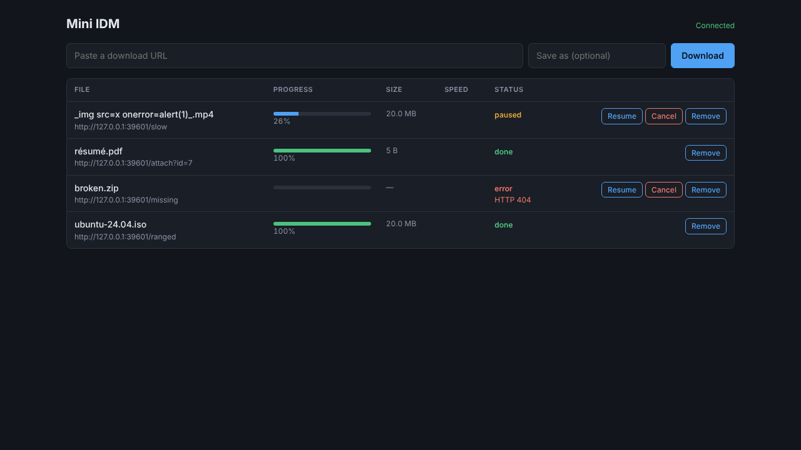

# Mini IDM

A small download manager modelled on Internet Download Manager's architecture: a
browser extension catches downloads and hands them to a local engine. The engine
downloads each file over several parallel HTTP connections, can pause and resume,
and shows progress live.

Node.js ≥ 18.17 with **zero runtime dependencies**, plus a Chrome/Edge (MV3) extension.



## How it maps to IDM

| IDM | Mini IDM | Notes |
|---|---|---|
| `IDMGCExt.crx` browser extension | `extension/` | Same three capture paths: browser-started downloads, link clicks, and media seen in page traffic |
| `IDMMsgHost.exe` native messaging bridge | `POST /api/downloads` on `127.0.0.1` with a bearer token | Simpler to run. See [Roadmap](#roadmap) for the native-messaging version |
| `IDMan.exe` segmented engine | `server/lib/downloader.js` | Dynamic segmentation, in-place writes, per-segment retry, resume |
| Download list / dialogs | `server/public/` web UI, extension popup | |
| `idmwfp*.sys` network driver | none | A network driver only sees encrypted HTTPS bytes anyway |

```
 Browser                                     Local engine (Node)
┌───────────────────────────────┐          ┌────────────────────────────────────┐
│ content.js   link clicks      │          │ app.js     HTTP API + SSE + web UI │
│ background.js                 │  HTTP →  │            token, Host & Origin    │
│   downloads.onCreated takeover│ ───────▶ │            checks                  │
│   webRequest media detection  │  POST    │ queue.js   max 3 active, persisted │
│   context menu                │  url +   │ downloader.js                      │
│   cookies (incl. HttpOnly)    │  cookies │   probe → steal → write in place   │
└───────────────────────────────┘          └──────────────┬─────────────────────┘
                                                          │ up to 8 Range connections
                                                          ▼
                                                     origin server
```

### How a download works

1. **Probe**: a `GET` with `Range: bytes=0-`, not `HEAD`, because signed URLs often refuse HEAD.
   Ranges are trusted only if the answer is `206` with `Content-Range`. A `200` means one plain stream.
2. **Dynamic segmentation**: the probe connection keeps reading from byte 0. Each extra connection
   (up to 8) takes the back half of the largest remaining segment, and so does any connection that
   finishes early. This is IDM's "dynamic segmentation".
3. **In-place writes**: every connection writes at its own offset in a pre-sized `name.part` file,
   so there is no merge step and no double disk usage.
4. **Resumable state**: the segment map is saved to `name.part.json` every second, recording only bytes
   that were actually written. Pause, crash or restart, then resume with `If-Range`. If the file changed
   on the server, it starts over.
5. **Failures**: each segment retries with backoff from its last written byte. Any HTTP error
   is an error, never a "completed" HTML error page.

## Quick start

```bash
cd server
npm start
# Mini IDM running at http://127.0.0.1:7878
# Saving to:       ~/Downloads/mini-idm
# Extension token: <token>
```

1. Open `chrome://extensions`, enable **Developer mode**, click **Load unpacked**, and choose the `extension/` folder.
2. The settings page opens. Paste the token and click **Test connection**, then **Save**.
3. Click a `.zip`/`.exe`/`.mp4` link, or any download, and it shows up in the extension popup and at
   <http://127.0.0.1:7878>.

Settings (env var, or `~/.mini-idm/config.json`):

| Env | Default |
|---|---|
| `MINI_IDM_PORT` | `7878` |
| `MINI_IDM_SAVE_DIR` | `~/Downloads/mini-idm` |
| `MINI_IDM_MAX_ACTIVE` | `3` |
| `MINI_IDM_HOME` | `~/.mini-idm` (config, token, queue) |

`Ctrl-C` pauses running downloads, and they can be resumed after the next start.

## Capture paths (extension)

- **Downloads the browser starts.** The URL goes to the server first. The browser download is cancelled
  only **after** the server accepts it, so if the server is down Chrome keeps the download.
  `blob:`/`data:` URLs are left alone because they only exist inside the browser.
- **Link clicks** on file-looking links. The link is sent before the browser requests it, which matters for
  one-time download links. If the server refuses, the extension starts a normal browser download, so the
  click is never lost.
- **Media detection**: response headers (`video/*`, `audio/*`, `Content-Disposition: attachment`, archive
  types) are watched in the background. Hits are listed in the popup with a **Download** button and are
  never downloaded automatically. HLS/DASH manifests are listed but not supported yet.
- **Right-click** → *Download link with Mini IDM* / *Download this media with Mini IDM*.

Cookies come from `chrome.cookies`, including HttpOnly and partitioned cookies, together with the
referrer and user agent. They are kept in memory only, never written to `queue.json`, and are not sent
across origins on redirects.

## Security model

A local download server is a juicy target: any website can try to send requests to `127.0.0.1`. So:

- It binds to `127.0.0.1` only.
- Every `/api` request needs the bearer token, compared in constant time.
- The `Host` header must be `127.0.0.1:PORT` or `localhost:PORT`, which blocks DNS rebinding.
- It sends **no CORS headers**. The extension doesn't need them (host permissions), and web pages can't read responses.
- A request with a foreign `Origin` is rejected even if it has a valid token.
- POST bodies must be `application/json`, so plain-text "simple" requests are refused.
- Only `http:`/`https:` URLs are accepted. Forwarded headers are whitelisted to Cookie, Referer, User-Agent and Accept-Language.
- The web UI has a strict CSP and renders filenames and URLs with `textContent`.

## Tests

```bash
cd server
npm test            # 25 tests, ~3 s, no dependencies
npm run test:e2e    # loads the real extension into Chromium (needs: npm i -D playwright)
```

`npm test` runs a local origin server that misbehaves on purpose: dropped connections, a server that
says `Accept-Ranges` but ignores Range, 404s, cross-origin redirects, `filename*=` headers, and slow
streams for pause/resume. The API tests cover token, Origin, Host, content-type and URL-scheme checks,
concurrency limits, and restart persistence.

`npm run test:e2e` checks, in a real browser: click capture with HttpOnly cookie forwarding, the
browser-download takeover, media detection without auto-download, and the fallback when the server refuses.

## Limitations

- No HLS/DASH reassembly (needs a manifest parser and ffmpeg for muxing).
- DRM-protected media (Widevine) cannot be downloaded by this or any download manager design.
- POST-form downloads are replayed as GET, so downloads that need a form POST fail on the server
  side (the item shows an error).
- No scheduler, site grabber, speed limiter or FTP.
- Firefox: the code is mostly compatible, but it's untested and the manifest needs `browser_specific_settings`.
- A browser-started download has already made one request before it is taken over, so strict one-time URLs
  can fail on that path. Click capture avoids this.

## Roadmap

- **Native messaging instead of an open port**: a small Node host (`com.miniidm.host`, stdio, 4-byte
  length-prefixed JSON) registered in `HKCU\Software\Google\Chrome\NativeMessagingHosts`. This mirrors
  `IDMMsgHost.exe`. Chrome only lets the listed extension talk to it, which removes the token, and Chrome
  can start the engine on demand.
- HLS/DASH: parse `.m3u8`/`.mpd`, download segments in parallel, mux with ffmpeg.
- Speed limiter (token bucket shared across connections) and a scheduler.

## Docs

- [`docs/PROMPT.md`](docs/PROMPT.md): the analysis and build spec this project follows, including how to
  analyse IDM itself with proven/inferred/hidden tagging.
- [`docs/REVIEW.md`](docs/REVIEW.md): what was wrong with the first draft of this project and how each
  issue was fixed and tested.
