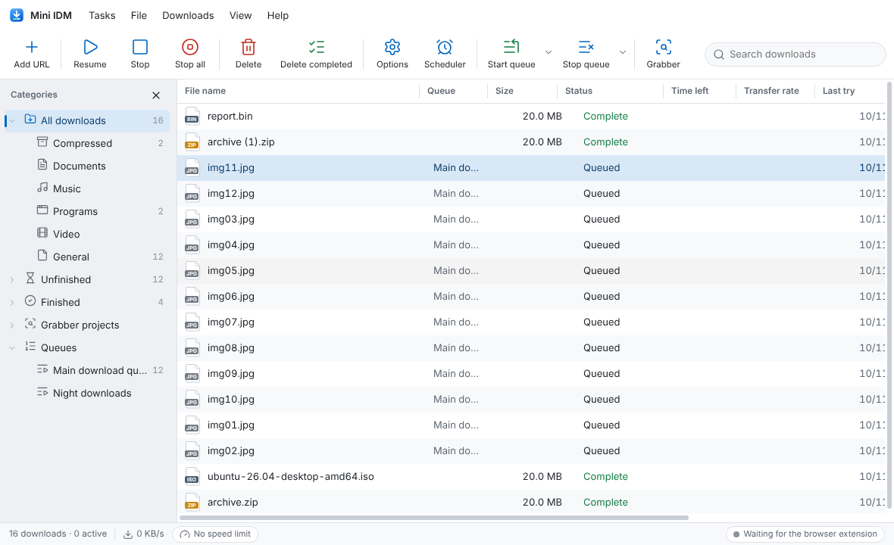
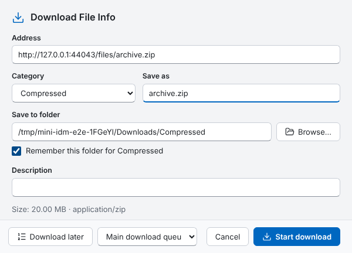
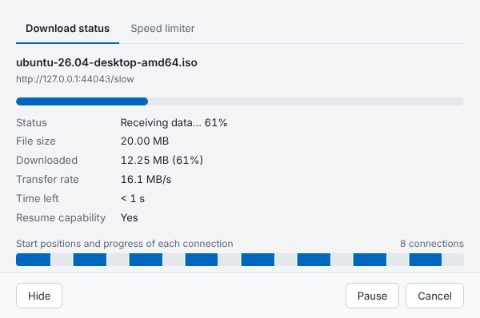
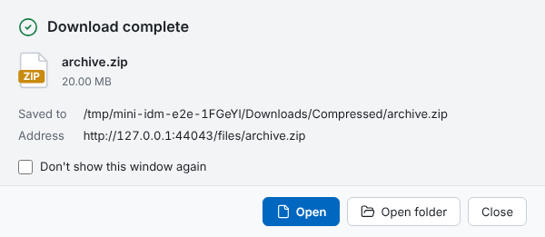
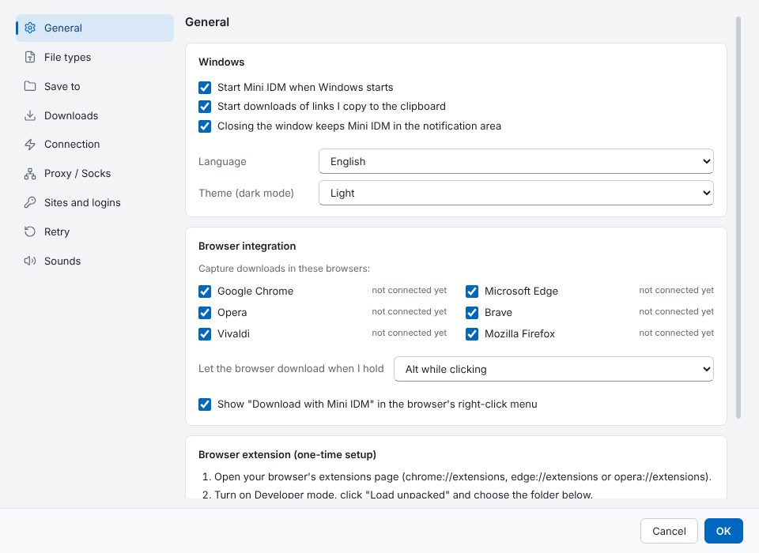
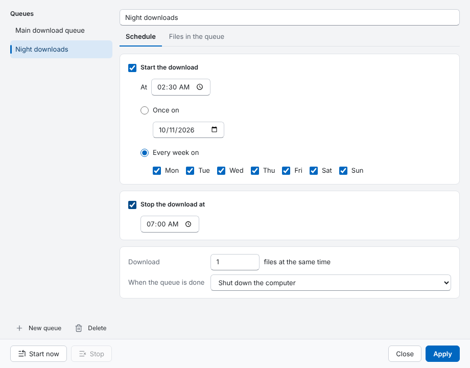
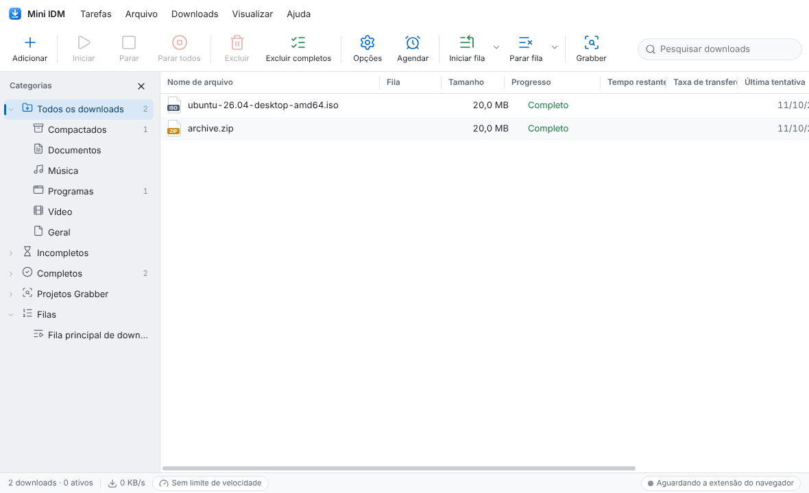
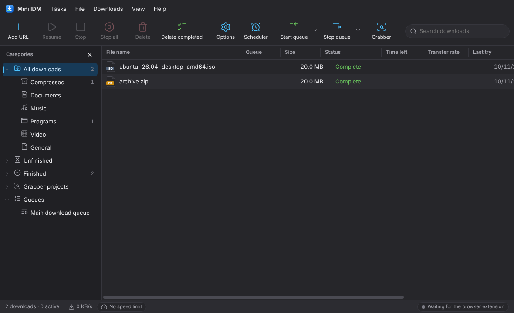

# Mini IDM

A download manager for Windows modelled on Internet Download Manager: the same
layout, menus, Options tabs, categories, queues and scheduler, with a 2026
Windows 11 look, dark mode, and English or Brazilian Portuguese.

The **program** does all the work. The small **browser extension** is only a
connector: it hands your downloads to the program and has nothing to set up.



| Download File Info | Progress | Download complete |
|---|---|---|
|  |  |  |

| Options | Scheduler | Português, dark mode |
|---|---|---|
|  |  |   |

## Install

1. Download **Mini-IDM-Setup-2.0.0.exe** from the [Releases page](../../releases) (or from the
   latest successful **Windows build** run under Actions).
2. Run it. The installer isn't code-signed, so Windows SmartScreen may show "Windows protected
   your PC": click **More info → Run anyway**.
3. Mini IDM starts and from then on starts with Windows, sitting in the notification area
   (next to the clock). Closing the window keeps it running there, like IDM.

### Connect your browser (once)

1. In Mini IDM open **Options → General**. Under *Browser extension* click **Open folder**.
2. In your browser open `opera://extensions` (or `chrome://extensions`, `edge://extensions`),
   turn on **Developer mode**, click **Load unpacked** and choose that folder.
3. That's it. There's nothing to configure in the extension. The status bar in Mini IDM shows
   "Connected: Opera" once the browser has talked to it.

If you used the earlier "npm start" version: stop that server first (it used the same port), and
load the extension from the new folder. The extension has a new fixed ID, so remove the old one.

## What it does (the features from IDM)

**Main window**: menu bar (Tasks, File, Downloads, View, Help), toolbar (Add URL, Resume, Stop,
Stop all, Delete, Delete completed, Options, Scheduler, Start/Stop queue, Grabber), category tree
(All downloads → Compressed, Documents, Music, Programs, Video, General; Unfinished; Finished;
Grabber projects; Queues), sortable and resizable columns (File name, Queue, Size, Status, Time left,
Transfer rate, Last try, Description), right-click menu, search, status bar with total speed.

**Downloading**: up to 32 connections per file with dynamic segmentation (a free connection takes
half of the largest remaining part), pause and resume (also after a restart), automatic retry,
direct writing (no temporary files to merge), duplicate-address handling, file names from the server.

**Browser capture**: downloads the browser starts, clicks on file links, right-click "Download with
Mini IDM", and videos/files spotted on the page (listed in the extension's popup). Your cookies
(including HttpOnly) go along so logged-in downloads work. Hold **Alt** while clicking to let the
browser download instead.

**Menus as in IDM**
- *Tasks*: Add URL, Add batch download (`img*.jpg` from 1 to 50), Site Grabber, Import/Export list, Exit
- *File*: Resume, Stop, Download again, Remove, Open, Open folder, Copy address, Properties
- *Downloads*: Pause all, Stop all, Delete all completed, Find (Ctrl+F), Find next (F3), Scheduler,
  Start queue ▸, Stop queue ▸, Speed limiter ▸ (on / off / settings), Options
- *View*: Hide categories, Arrange files by ▸, Toolbar ▸, Columns ▸, tray icon, Theme (dark mode),
  Font size, Language
- *Help*: Help, Report a problem, Check for updates, About

**Options (all 9 tabs)**

| Tab | What you can set |
|---|---|
| General | Start with Windows, clipboard monitoring, which browsers to capture from, the bypass key, the right-click menu, language, theme, extension folder |
| File types | Types captured automatically (IDM's default list), sites and addresses never to capture |
| Save to | Categories with their folder and file types, new/edit/delete categories, remember last folder, file date from the server |
| Downloads | Show Download File Info / progress / complete windows, duplicate-address rule, User-Agent, antivirus scan after download (Microsoft Defender by default) |
| Connection | Connections per download (1–32), downloads at the same time, per-server exceptions, speed limiter, download limits (X MB every Y hours) |
| Proxy / Socks | None, Windows settings, automatic script (PAC), or manual HTTP / SOCKS5 with login |
| Sites and logins | User name and password per site, host, wildcard or path |
| Retry | Attempts (0 = keep trying) and the wait between them. IDM's dial-up/VPN options aren't needed on modern Windows. |
| Sounds | Download complete, download failed, queue started, queue finished: built-in tone or your own file |

**Scheduler**: any number of queues; start once or on chosen weekdays at a time, stop at a time,
N files at once, then do nothing / exit / shut down / sleep; file order inside each queue.

## Not included

- **Video download buttons and HLS/DASH streams.** That's IDM's most-used extra and the next big step.
- DRM-protected video (no download manager can legally do this).
- FTP and MMS, IDM's toolbar button inside web pages, and registration.
- Firefox: the extension targets Chrome, Edge, Opera, Brave and Vivaldi.

## For developers

```
app/            the Windows program (Electron)
  engine/       download engine: downloader, manager (queues, limits, retries), settings,
                scheduler, proxy, rules, grabber, batch, browser bridge
  main/         program shell: windows, tray, start with Windows, IPC, notifications, sounds
  renderer/     the windows (plain HTML/CSS/JS, strict CSP, no Node access)
  locales/      en.json, pt-BR.json
  test/         engine tests (node:test)
  test-e2e/     drives the real program and extension (Playwright)
extension/      the browser connector (Manifest V3)
docs/           screenshots, the original analysis prompt and review
```

```bash
cd app
npm install
npm start            # run the program
npm test             # 48 engine tests: segmentation, resume, queues, scheduler, proxies, quota…
npm run test:e2e     # real program + real extension (needs: npm i -D playwright)
npm run dist         # Windows installer in app/dist (on Linux this needs Wine)
```

Pushing a tag like `v2.0.1` makes the **Windows build** workflow run the tests on Windows,
build the installer, and attach it to a GitHub release.

### How the browser connection is secured

The program listens on `127.0.0.1:7878` only. It accepts requests from the Mini IDM extension
(recognised by its fixed ID, which browsers put in the `Origin` header and web pages cannot fake)
or with the token in `%APPDATA%\Mini IDM\config.json`. There are no CORS headers, the `Host` header
is checked (no DNS rebinding), only JSON is accepted, and forwarded request headers are limited
to cookies, referrer, user agent and language. Cookies are kept in memory only.
