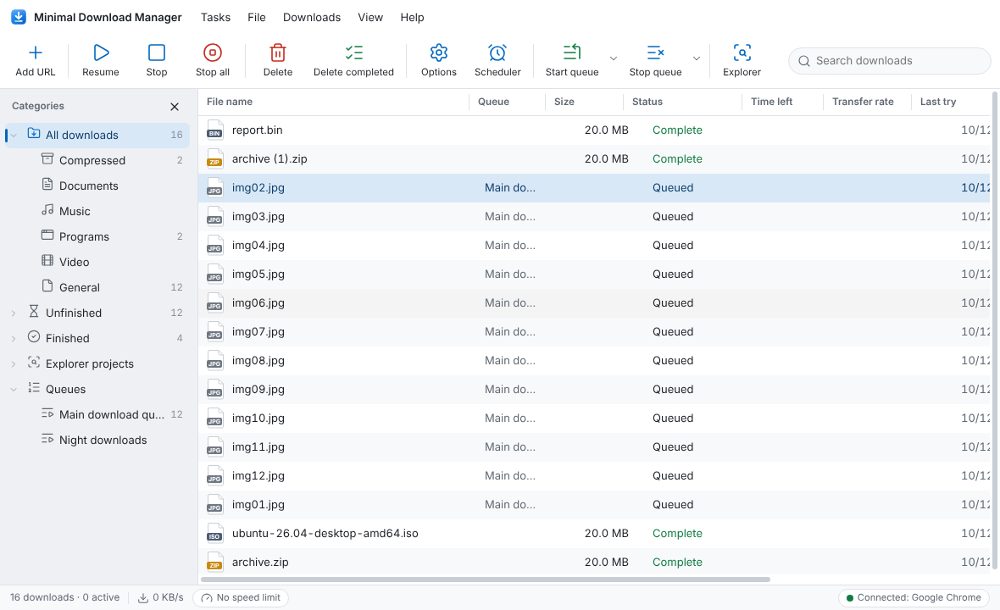
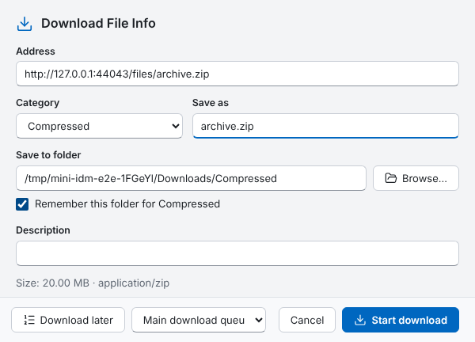
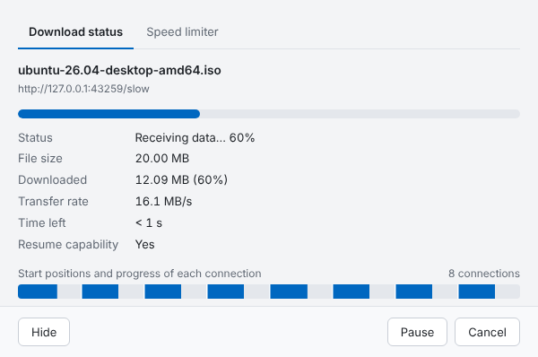
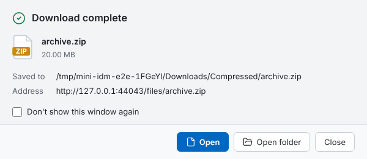
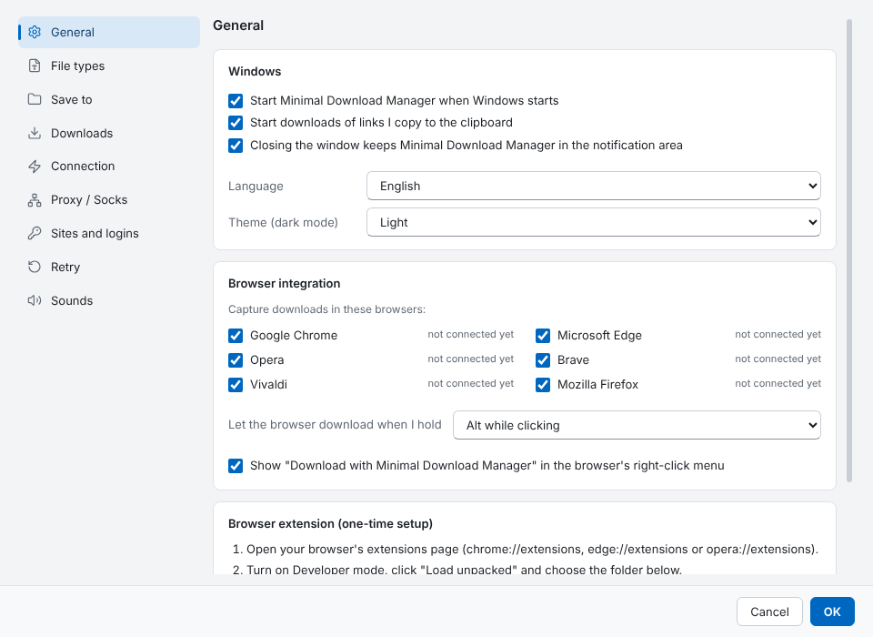
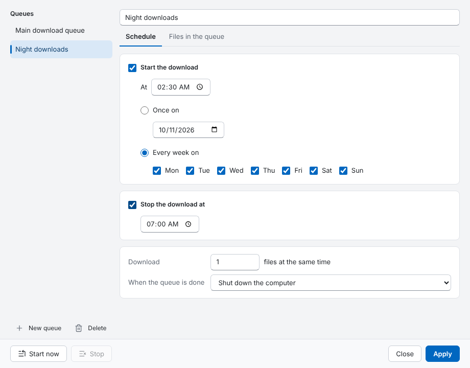
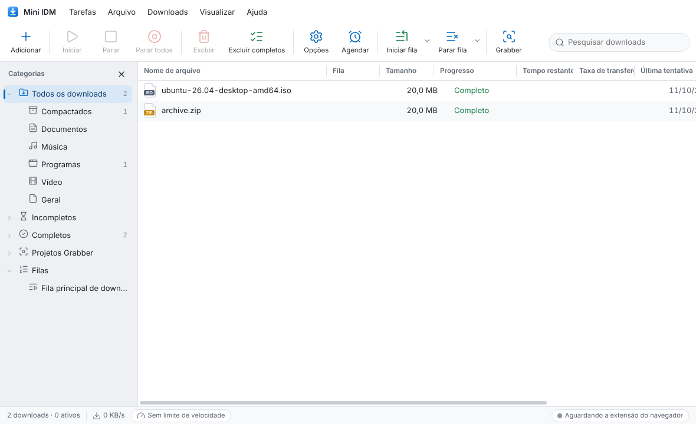
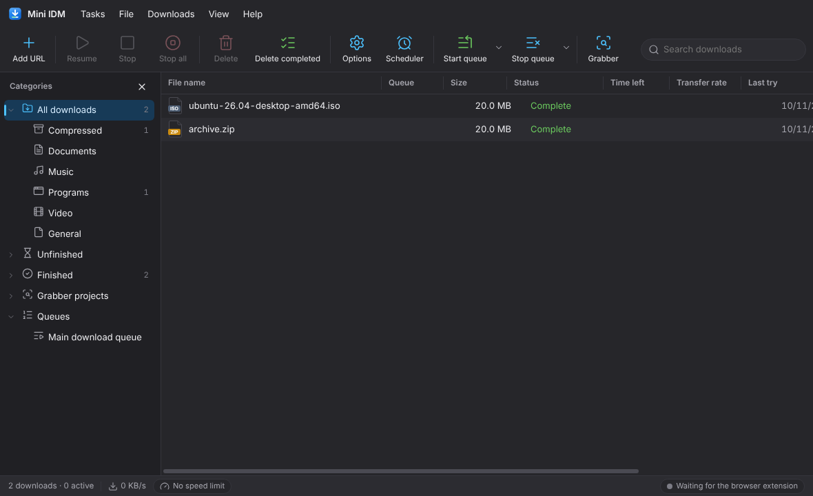

# Minimal Download Manager

A fast, lightweight download manager for Windows: segmented downloads with up to 32 connections,
categories, queues, a scheduler, browser capture, a Windows 11 look and dark mode.

The **program** does all the work. The small **browser extension** is only a connector: it hands
your downloads to the program and has nothing to set up.



| New download | Progress | Download complete |
|---|---|---|
|  |  |  |

| Options | Scheduler | Português, dark mode |
|---|---|---|
|  |  |   |

## New in 3.0: rebuilt in Rust

Version 3.0 is a full rewrite of the program in **Rust** with **Tauri**. It looks and works the same
as 2.x, but under the hood everything that downloads, saves and talks to the browser is new.

- **About 3.5 MB to download.** The installer no longer carries its own copy of Chromium and Node.js.
  The windows use Microsoft Edge WebView2, which is already part of Windows 10 and 11.
- **A native download engine.** Downloads run on Rust's async runtime instead of a JavaScript event loop:
  - Each part of a file gets its **own connection** (HTTP/1.1), so 8 or 32 connections really are 8
    or 32 streams.
  - Data is written to disk in **256 KB batches** straight into place, instead of one disk write per
    small network packet.
  - Big files are created as **sparse files**, so Windows doesn't fill gigabytes with zeros before a
    connection far into the file can start writing.
- **Safer resume.** Pausing, quitting or losing the network while a resume is still connecting no
  longer throws away the partly downloaded file.
- **A tiny browser helper.** The process the browser starts (`mdm-host.exe`, under 1 MB) is now a native program.
  It no longer starts a script through a batch file and a copy of the app runtime.
- **Your data comes along.** 3.0 reads the 2.x download list, settings and saved passwords. Downloads
  paused in 2.x resume where they stopped.
- **Same windows, same extension.** Nothing to relearn and nothing to reinstall in the browser.

## Install

1. Download **Minimal-Download-Manager-Setup-3.0.0.exe** from the [Releases page](../../releases).
   Optionally check it: the release page lists its SHA-256, which PowerShell's
   `Get-FileHash .\Minimal-Download-Manager-Setup-3.0.0.exe` must match.
2. Run it. The installer isn't code-signed yet (see [Releases](#releases)), so Windows SmartScreen
   may show "Windows protected your PC": click **More info → Run anyway**.
3. Minimal Download Manager starts and from then on starts with Windows, sitting in the notification area
   (next to the clock). Closing the window keeps it running there.

### Coming from 2.x

Quit 2.x (right-click the tray icon → Exit) and **uninstall it first**. The 3.0 installer is a
different kind and doesn't replace the old one. Uninstalling keeps your data in
`%APPDATA%\Minimal Download Manager`, and 3.0 picks it up: your list, settings, categories, queues
and saved logins. Back that folder up first if you want to be safe.

### Connect your browser (once)

1. In Minimal Download Manager open **Options → General**. Under *Browser extension* click **Open folder**.
2. In your browser open `opera://extensions` (or `chrome://extensions`, `edge://extensions`),
   turn on **Developer mode**, click **Load unpacked** and choose that folder.
3. That's it. There's nothing to configure in the extension. The status bar in Minimal Download Manager shows
   "Connected: Opera" once the browser has talked to it.

Already connected in 2.x? Just click the reload button (↻) on Minimal Download Manager in your
browser's extensions page, or restart the browser.

## Features

**Downloading**
- Up to **32 connections per file** with dynamic segmentation: a free connection takes the back half
  of the largest part still left, so all connections stay busy until the end.
- Pause and resume, also after closing the program or restarting Windows.
- Automatic retry with a wait you choose, plus quick retries for dropped connections. A retry continues from the last byte saved.
- Direct writing into the final file: no temporary pieces to merge at the end.
- File names from the server (`Content-Disposition`, including international names). A name that
  is only an ID in the address gives way to the server's real file name.
- A new name such as `file (1).zip` when the name is taken, so nothing is ever overwritten by accident.
- Duplicate addresses: ask, add a numbered copy, overwrite, or resume the existing one.
- Speed limiter shared by all downloads, and download limits (X MB every Y hours) with a warning.
- Optional file date from the server, and an optional antivirus scan after each download
  (Microsoft Defender by default).

**Browser capture**
- Downloads the browser starts, clicks on file links, right-click **Download with Minimal Download
  Manager**, and videos/files spotted on the page (listed in the extension's popup).
- The site's cookies (including HttpOnly) go along so logged-in downloads work; you can switch that
  off in Options → General. Hold **Alt** while clicking to let the browser download instead.
- Clipboard monitoring: copy a download link and the New download window opens.
- `minimaldm://add?url=…` links open the New download window.

**Organising**
- Categories (Compressed, Documents, Music, Programs, Video, General, plus your own), each with its
  folder and file types; remembers the last folder per category.
- Queues with their own order and number of files at once.
- Scheduler: start a queue once or on chosen weekdays at a time, stop it at a time, then do nothing,
  exit, shut down or sleep.
- Batch download (`img*.jpg` from 1 to 50, zero-padded or letters), Site Explorer (finds files of
  chosen types on a page and the pages it links to), import and export of address lists.

**Main window**: menu bar (Tasks, File, Downloads, View, Help), toolbar (Add URL, Resume, Stop,
Stop all, Delete, Delete completed, Options, Scheduler, Start/Stop queue, Explorer), category tree
(All downloads → Compressed, Documents, Music, Programs, Video, General; Unfinished; Finished;
Explorer projects; Queues), sortable and resizable columns (File name, Queue, Size, Status, Time left,
Transfer rate, Last try, Description), right-click menu, search, status bar with total speed.

**Menus**
- *Tasks*: Add URL, Add batch download, Site Explorer, Import/Export list, Exit
- *File*: Resume, Stop, Download again, Remove, Open, Open folder, Copy address, Properties
- *Downloads*: Pause all, Stop all, Delete all completed, Find (Ctrl+F), Find next (F3), Scheduler,
  Start queue ▸, Stop queue ▸, Speed limiter ▸ (on / off / settings), Options
- *View*: Hide categories, Arrange files by ▸, Toolbar ▸, Columns ▸, tray icon, Theme (dark mode),
  Font size, Language
- *Help*: Help, Report a problem, Check for updates, About

**Options (all 9 tabs)**

| Tab | What you can set |
|---|---|
| General | Start with Windows, clipboard monitoring, which browsers to capture from, the bypass key, the right-click menu, sending cookies, language, theme, extension folder, the old port-7878 connection (off) |
| File types | Types captured automatically, sites and addresses never to capture |
| Save to | Categories with their folder and file types, new/edit/delete categories, remember last folder, file date from the server |
| Downloads | Show the New download / progress / complete windows, duplicate-address rule, User-Agent, antivirus scan after download |
| Connection | Connections per download (1–32), downloads at the same time, per-server exceptions, speed limiter, download limits (X MB every Y hours) |
| Proxy / Socks | None, Windows settings, automatic script (PAC), or manual HTTP / SOCKS5 with login |
| Sites and logins | User name and password per site, host, wildcard or path (sent over HTTPS only, stored encrypted) |
| Retry | Attempts (0 = keep trying) and the wait between them |
| Sounds | Download complete, download failed, queue started, queue finished: built-in tone or your own file |

**Languages**: English and Português (Brasil), chosen from Windows or set by hand.

## Not included

- **Video download buttons and HLS/DASH streams.** The next big step.
- DRM-protected video (no download manager can legally do this).
- FTP and MMS, and a download button inside web pages.
- Firefox: the extension targets Chrome, Edge, Opera, Brave and Vivaldi.

## For developers

```
crates/mdm-core/  download engine: downloader, manager (queues, limits, retries, quota), settings,
                  scheduler, proxy, rules, site explorer, batch, browser bridge, pipe protocol
crates/mdm-host/  native messaging host the browser starts (mdm-host.exe)
app/              program shell (Tauri 2): windows, tray, start with Windows, IPC, notifications,
                  sounds, DPAPI passwords, WinHTTP proxy
ui/               the windows (plain HTML/CSS/JS, strict CSP)
extension/        the browser connector (Manifest V3)
scripts/          installer build
docs/             screenshots
```

Needs Rust (stable, MSVC) and the Visual Studio C++ Build Tools.

```bash
cargo test --workspace                       # engine tests: segmentation, resume, queues, quota, bridge…
cargo build --workspace && cargo run -p minimal-download-manager   # run the program (a debug build never touches autostart or browser keys)
cargo install tauri-cli --version "^2" --locked
pwsh scripts/build-installer.ps1             # installer in target/release/bundle/nsis
```

Every push to `main` makes the **Windows build** workflow run the tests on Windows, build the
installer, and publish it as the release for the version in `app/tauri.conf.json`. A version that is
already released is never replaced: raise the version to publish changes.

## Security

### How the browser connection works

The extension talks to the program through **native messaging**:

```
extension ──native messaging──▶ host (started by the browser) ──private pipe──▶ program
```

- The program registers the host for your Windows user on every start (`HKCU\Software\Google\Chrome\NativeMessagingHosts`
  and the Edge/Brave/Chromium keys; Opera and Vivaldi read Chrome's). The browser only lets the
  extension with our fixed ID start it.
- The host reaches the program over a Windows named pipe. Before anything else, both sides prove
  they know a random secret in `%APPDATA%\Minimal Download Manager\config.json`, a file only your
  Windows user can read. Other programs, and other users on the PC, can't add downloads or receive
  your cookies through it, and the host never talks to a program pretending to be ours.
- No network port is open. The old `127.0.0.1:7878` connection is **off**. It can be switched on in
  Options → General for a browser that can't use native messaging. While it is on, any program
  running on your PC could send it a download, because programs (unlike web pages) can fake the
  `Origin` header.
- Only cookies, referrer, user agent and language are passed on, and only for the download's own
  address. Cookies stay in memory and are never written to disk. They aren't sent again after a
  redirect to another site.

### Passwords

Passwords in *Sites and logins* and the proxy settings are stored encrypted with Windows DPAPI
(`enc:` in `settings.json`). Only your Windows user on this PC can decrypt them. Passwords saved by
2.x are still read, and are saved in the 3.0 format the next time a setting changes. Saved logins are only sent over **HTTPS**. A site
entered as `http://…` (for example an old router) is the one exception, and only because you typed
it that way.

### Releases

- Each version is built by GitHub Actions from the public source and published once. A release is
  never replaced later.
- The release notes and `SHA256SUMS.txt` give the installer's SHA-256.
- A signed [build provenance attestation](https://docs.github.com/actions/security-for-github-actions/using-artifact-attestations)
  ties the file to the exact commit and workflow. Check it with
  `gh attestation verify Minimal-Download-Manager-Setup-<version>.exe --owner newroidorder`.
- The installer is **not code-signed** yet, which is why SmartScreen warns. Free signing for
  open-source projects is available from [SignPath Foundation](https://signpath.org/); Azure Trusted
  Signing is a low-cost paid option.
